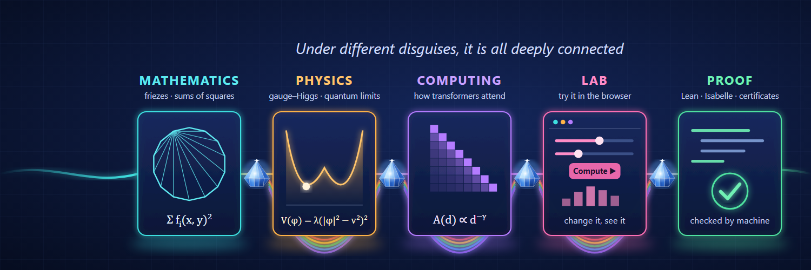

<p align="center">
  
</p>

<h1 align="center">💎 Carles Marín · Research</h1>

<p align="center">
  <em>What moves me is curiosity about the details that nature hides.</em><br>
  Research papers in mathematics, physics and computing, with their proofs, data and code.
</p>

<p align="center">
  <a href="https://karlesmarin.github.io/"></a>
  <a href="https://karlesmarin.github.io/papers/"></a>
  <a href="https://orcid.org/0009-0007-5637-9688"></a>
</p>

---

## 🧭 What you will find here

| | Where | What it is |
|---|---|---|
| 📚 | **[Papers](https://karlesmarin.github.io/papers/)** | Every preprint, one page each, with the abstract, the PDF, the DOI and links to everything around it. Filter by area and year, or search. |
| 🏛️ | **[Atlas of blueprints](https://karlesmarin.github.io/blueprints/)** | One companion site per paper: each statement linked to its proof, its dependencies, an interactive lab and, where it exists, its machine-checked version. |
| 🧱 | **[Lean library](https://karlesmarin.github.io/blueprints/reusable/)** | Reusable Lean 4 pieces extracted from the papers, with a practical guide. |
| ✅ | **[Formal proofs](https://github.com/karlesmarin/formalizations)** | Lean and Isabelle formalizations of results from the papers. |
| 🗄️ | **[Zenodo](https://zenodo.org/search?q=metadata.creators.person_or_org.identifiers.identifier%3A0009-0007-5637-9688)** | The archived records: papers, data and software, each with its DOI. |
| 🐘 | **[Mathstodon](https://mathstodon.xyz/@karlesmarin)** | Short threads on each result as it comes out. |

<!-- PAPERS:START (generado por excovery.publicaciones; no editar a mano) -->

## 📚 All papers (73)

<sub>Updated automatically from Zenodo and arXiv. Newest first within each area.</sub>

<details open>
<summary><b>🔷 Mathematics</b> · 48</summary>

| Date | Paper | Links |
|---|---|---|
| 2026-11-27 | 🔢 [How Many Dyck Words Do the Divisors of an Integer Make? II. Generic Rigidity and Persistent Ambiguity](https://karlesmarin.github.io/papers/dyck-divisors-rigidity/) | [🔗 DOI](https://doi.org/10.5281/zenodo.24572754) · [📘 blueprint](https://karlesmarin.github.io/blueprints/dyck-divisors-rigidity/) · [🧪 labs](https://karlesmarin.github.io/blueprints/dyck-divisors-rigidity/index.html?lab=thm:rigid) |
| 2026-11-26 | 🌳 [Maximum number of spanning trees of a multigraph with m edges: exact values for m ≤ 22](https://karlesmarin.github.io/papers/maximum-number-of-spanning-trees-of-a-multigraph-with-m/) | [🔗 DOI](https://doi.org/10.5281/zenodo.24561280) · [📘 blueprint](https://karlesmarin.github.io/blueprints/kenyon-spanning-trees/) · [🧪 labs](https://karlesmarin.github.io/blueprints/kenyon-spanning-trees/index.html?lab=thm:cert) |
| 2026-11-25 | 🔢 [How Many Dyck Words Do the Divisors of an Integer Make? Exact Counts and Quasipolynomial Growth](https://karlesmarin.github.io/papers/dyck-divisors/) | [🔗 DOI](https://doi.org/10.5281/zenodo.24541288) · [📘 blueprint](https://karlesmarin.github.io/blueprints/dyck-divisors/) · [🧪 labs](https://karlesmarin.github.io/blueprints/dyck-divisors/index.html?lab=lem:reduction) |
| 2026-11-25 | 🧮 [Every m×4 biquadratic sum of squares is a sum of 3m−1 squares (5 ≤ m ≤ 16)](https://karlesmarin.github.io/papers/bsr-m-four/) | [🔗 DOI](https://doi.org/10.5281/zenodo.24522234) · [📘 blueprint](https://karlesmarin.github.io/blueprints/bsr-m-four/) · [🧪 labs](https://karlesmarin.github.io/blueprints/bsr-m-four/index.html?lab=thm:main) |
| 2026-11-21 | ⬡ [Rational sums-of-squares lengths of biquadratic forms and orthogonal dilations](https://karlesmarin.github.io/papers/real-rational-integer/) | [🔗 DOI](https://doi.org/10.5281/zenodo.24413664) · [📘 blueprint](https://karlesmarin.github.io/blueprints/real-rational-integer/) · [🧪 labs](https://karlesmarin.github.io/blueprints/real-rational-integer/index.html?lab=thm:gap) |
| 2026-11-14 | 📄 [On z_2M(21,4): the Hole Extensions of the Chen–Chen Configuration Are Reducible, and the Extremal Configurations of z₂(21,4) Are Not Unique](https://karlesmarin.github.io/papers/z2m-21-4-hole-extensions/) | [🔗 DOI](https://doi.org/10.48550/arXiv.2611.19437) · [📄 arXiv](https://arxiv.org/abs/2611.19437) |
| 2026-11-09 | 💠 [Integer character values on the ρ-line of Sp(2m)](https://karlesmarin.github.io/papers/characters-at-aP/) | [🔗 DOI](https://doi.org/10.5281/zenodo.24073781) · [📘 blueprint](https://karlesmarin.github.io/blueprints/characters-at-aP/) · [🧪 labs](https://karlesmarin.github.io/blueprints/characters-at-aP/index.html?lab=thm:clasif) |
| 2026-11-08 | 🧩 [Every 4×4 biquadratic sum of squares is a sum of eleven squares](https://karlesmarin.github.io/papers/bsr-four-four/) | [🔗 DOI](https://doi.org/10.5281/zenodo.24055900) · [📘 blueprint](https://karlesmarin.github.io/blueprints/bsr-four-four/) · [🧪 labs](https://karlesmarin.github.io/blueprints/bsr-four-four/index.html?lab=lem:regular) |
| 2026-11-08 | 🧮 [For m ≥ 2, every m×3 biquadratic sum of squares is a sum of 2m squares](https://karlesmarin.github.io/papers/bsr-width-three/) | [🔗 DOI](https://doi.org/10.5281/zenodo.24051362) · [📘 blueprint](https://karlesmarin.github.io/blueprints/bsr-width-three/) · [🧪 labs](https://karlesmarin.github.io/blueprints/bsr-width-three/index.html?lab=thm:main) |
| 2026-11-08 | 🧮 [Quadratic persistence of Segre varieties and a linear gap between biquadratic SOS rank and Zarankiewicz bounds](https://karlesmarin.github.io/papers/segre-persistence-bsr/) | [🔗 DOI](https://doi.org/10.5281/zenodo.24036320) · [📘 blueprint](https://karlesmarin.github.io/blueprints/segre-persistence-bsr/) · [🧪 labs](https://karlesmarin.github.io/blueprints/segre-persistence-bsr/index.html?lab=cor:bsr) |
| 2026-11-01 | 🔺 [Why three blocks? The limited augmented Zarankiewicz number in fixed width](https://karlesmarin.github.io/papers/zl-three-blocks/) | [🔗 DOI](https://doi.org/10.5281/zenodo.23860725) · [📘 blueprint](https://karlesmarin.github.io/blueprints/zl-three-blocks/) · [🧪 labs](https://karlesmarin.github.io/blueprints/zl-three-blocks/index.html?lab=def) |
| 2026-10-26 | 🧩 [Integer frieze patterns and Tabachnikov's four sign changes](https://karlesmarin.github.io/papers/integer-frieze-sign-changes/) | [🔗 DOI](https://doi.org/10.5281/zenodo.23656979) · [📘 blueprint](https://karlesmarin.github.io/blueprints/integer-frieze-sign-changes/) · [🧪 labs](https://karlesmarin.github.io/blueprints/integer-frieze-sign-changes/index.html?lab=thm:B) |
| 2026-10-19 | 🧩 [Inversion height two in the free field of the free group: strict hierarchies and a non-membership criterion](https://karlesmarin.github.io/papers/inversion-height-two/) | [🔗 DOI](https://doi.org/10.5281/zenodo.23481332) · [📘 blueprint](https://karlesmarin.github.io/blueprints/inversion-height-two/) · [🧪 labs](https://karlesmarin.github.io/blueprints/inversion-height-two/index.html?lab=lem:4.1) |
| 2026-10-03 | 🎵 [Huddling, diatonic and pentatonic scales in Z12: Fourier maxima and convex-energy minima formalized in Lean 4](https://karlesmarin.github.io/papers/huddling-scales/) | [🔗 DOI](https://doi.org/10.5281/zenodo.23123219) · [📘 blueprint](https://karlesmarin.github.io/blueprints/huddling-scales/) · [🧪 labs](https://karlesmarin.github.io/blueprints/huddling-scales/index.html?lab=thm:huddling) |
| 2026-10-03 | 🎵 [The Tonnetz spectrum is the generating triad's Fourier balance profile](https://karlesmarin.github.io/papers/tonnetz-spectrum/) | [🔗 DOI](https://doi.org/10.5281/zenodo.23121105) |
| 2026-09-30 | 💠 [Where the character values of Sp(2m) at a torsion element fail to generate the ring of integers](https://karlesmarin.github.io/papers/conductor-rho-line/) | [🔗 DOI](https://doi.org/10.5281/zenodo.23061900) |
| 2026-09-22 | 🧮 [Subsets of F_p with two prescribed moments, Part II: every exponent — the classification, the Cauchy-Liouville-Mirimanoff polynomials that decide the column n=3, and where this moment subset sum stops being PORC](https://karlesmarin.github.io/papers/prescribed-moments-II/) | [🔗 DOI](https://doi.org/10.5281/zenodo.22886543) · [📘 blueprint](https://karlesmarin.github.io/blueprints/prescribed-moments-II/) · [🧪 labs](https://karlesmarin.github.io/blueprints/prescribed-moments-II/index.html?lab=thm:clasificacion) |
| 2026-09-22 | 🔢 [Subsets of F_p with two prescribed moments, Part I: the pair (1,3) — a moment subset sum over F_p: exact counts of totally split squarefree polynomials with a non-consecutive pair of prescribed coefficients, and exactly when those counts are elementary](https://karlesmarin.github.io/papers/prescribed-moments-I/) | [🔗 DOI](https://doi.org/10.5281/zenodo.22886541) |
| 2026-09-20 | 🧮 [The order generated by a column of the SU(n)_k S-matrix is locally a numerical semigroup ring (Part II)](https://karlesmarin.github.io/papers/s-matrix-orders-II/) | [🔗 DOI](https://doi.org/10.5281/zenodo.22864267) · [📘 blueprint](https://karlesmarin.github.io/blueprints/s-matrix-orders-II/) |
| 2026-09-19 | 🧮 [The order generated by a column of the SU(n)_k S-matrix is locally a numerical semigroup ring (Part I)](https://karlesmarin.github.io/papers/s-matrix-orders-I/) | [🔗 DOI](https://doi.org/10.5281/zenodo.22848530) · [📘 blueprint](https://karlesmarin.github.io/blueprints/s-matrix-orders-I/) |
| 2026-09-19 | 💠 [The ring of character values depends only on the segment: SU(n), Sp(2m) and GL(n) at a torsion element](https://karlesmarin.github.io/papers/character-ring-segment/) | [🔗 DOI](https://doi.org/10.5281/zenodo.22847477) |
| 2026-09-19 | ⚖️ [Zeros of weighted partial sums of completely multiplicative functions: Dirichlet characters, the Euler factor at 2 and Conrey's sine series](https://karlesmarin.github.io/papers/weighted-partial-sums/) | [🔗 DOI](https://doi.org/10.5281/zenodo.22847375) · [📘 blueprint](https://karlesmarin.github.io/blueprints/weighted-partial-sums/) |
| 2026-08-18 | 🔢 [Schur polynomials twisted by roots of unity and reciprocal pairs: torsion filters, fusion quotients, and total unimodularity at odd order](https://karlesmarin.github.io/papers/schur-twisted-torsion-filters/) | [🔗 DOI](https://doi.org/10.48550/arXiv.2608.18302) · [📄 arXiv](https://arxiv.org/abs/2608.18302) |
| 2026-08-10 | 🔢 [Schur polynomials twisted by roots of unity and reciprocal pairs: exactly three factors, and where they vanish](https://karlesmarin.github.io/papers/schur-twisted-three-factors/) | [🔗 DOI](https://doi.org/10.48550/arXiv.2608.09619) · [📄 arXiv](https://arxiv.org/abs/2608.09619) |
| 2026-07-21 | 🕸️ [The Set That Says No: Transversal Matroids in Lean 4, a Tight-Set Proof of Augmentation, and the Canonical Obstruction It Makes Possible](https://karlesmarin.github.io/papers/transversal-matroids/) | [🔗 DOI](https://doi.org/10.5281/zenodo.21470202) |
| 2026-07-17 | 🎼 [When Separation Fails, a Canon Appears: One counting identity behind separation, synchronization, and symmetry-breaking in permutation groups, formalized in Lean 4 (Part I)](https://karlesmarin.github.io/papers/separation-canon/) | [🔗 DOI](https://doi.org/10.5281/zenodo.21419285) |
| 2026-06-27 | 🎵 [The per-voice Fourier signature: the bass is the spectrally purest voice](https://karlesmarin.github.io/papers/per-voice-fourier/) | [🔗 DOI](https://doi.org/10.5281/zenodo.20971090) |
| 2026-06-27 | 🎵 [One transform and one duality: a machine-checked core of music theory in Lean 4](https://karlesmarin.github.io/papers/music-theory-core/) | [🔗 DOI](https://doi.org/10.5281/zenodo.20953768) |
| 2026-06-24 | 🎵 [The phase taxonomy of pitch-class set invariants](https://karlesmarin.github.io/papers/phase-taxonomy/) | [🔗 DOI](https://doi.org/10.5281/zenodo.20826774) |
| 2026-06-24 | 🎵 [A tritone-centered self-duality: the set class 6-30 and its order-12 neo-Riemannian dual](https://karlesmarin.github.io/papers/tritone-self-duality/) | [🔗 DOI](https://doi.org/10.5281/zenodo.20820962) |
| 2026-06-21 | 🪂 [How a Falling Particle Counts Its Floors: the Airy function as a verified entire solution of y''=xy, its oscillation, and the quantum-bouncer spectrum, machine-checked in Lean 4](https://karlesmarin.github.io/papers/airy-function/) | [🔗 DOI](https://doi.org/10.5281/zenodo.20787671) |
| 2026-06-21 | 📐 [What Order a Method Knows: certified Runge–Kutta order conditions over rooted trees, machine-checked in Lean 4](https://karlesmarin.github.io/papers/runge-kutta-order/) | [🔗 DOI](https://doi.org/10.5281/zenodo.20787666) |
| 2026-06-20 | 🌳 [How a Tree Forgets Its Order: the Eulerian idempotent and the Adams spectrum on the commutative Connes–Kreimer–Butcher Hopf algebra of rooted trees, machine-checked in Lean 4](https://karlesmarin.github.io/papers/eulerian-idempotent/) | [🔗 DOI](https://doi.org/10.5281/zenodo.20774821) |
| 2026-06-19 | 🌳 [How a Tree Remembers Its Cuts: the Connes--Kreimer--Foissy Hopf Algebra of Rooted Trees, Machine-Checked in Lean 4](https://karlesmarin.github.io/papers/connes-kreimer-foissy/) | [🔗 DOI](https://doi.org/10.5281/zenodo.20762280) |
| 2026-06-17 | 📉 [One Engine, Three Counts: Descartes, Sturm and Budan-Fourier through one sign-variation engine in Lean 4](https://karlesmarin.github.io/papers/descartes-sturm-budan/) | [🔗 DOI](https://doi.org/10.5281/zenodo.20736391) |
| 2026-06-17 | 📉 [Roots That Are Always There: the Virtual Roots of a Real Polynomial, Machine-Checked in Lean 4](https://karlesmarin.github.io/papers/virtual-roots/) | [🔗 DOI](https://doi.org/10.5281/zenodo.20736336) |
| 2026-06-17 | 📉 [Counting with the Derivative Tower: the Budan-Fourier Theorem, Machine-Checked in Lean 4](https://karlesmarin.github.io/papers/budan-fourier/) | [🔗 DOI](https://doi.org/10.5281/zenodo.20736143) |
| 2026-06-15 | 📉 [The Staircase of Signs: Sturm's Root-Counting Theorem, Machine-Checked in Lean 4](https://karlesmarin.github.io/papers/sturm/) | [🔗 DOI](https://doi.org/10.5281/zenodo.20707348) |
| 2026-06-14 | 📈 [The Inward Bow of a Real-Rooted Polynomial: Newton's Inequalities, Machine-Checked in Lean 4](https://karlesmarin.github.io/papers/newton-inequalities/) | [🔗 DOI](https://doi.org/10.5281/zenodo.20693064) · [📘 blueprint](https://karlesmarin.github.io/blueprints/newton-inequalities/) |
| 2026-06-13 | 🌀 [The Pentagon, Machine-Checked: Abel's five-term relation for the dilogarithm in Lean 4](https://karlesmarin.github.io/papers/dilogarithm-pentagon/) | [🔗 DOI](https://doi.org/10.5281/zenodo.20682716) · [📘 blueprint](https://karlesmarin.github.io/blueprints/dilogarithm-pentagon/) |
| 2026-06-11 | 🪟 [The Walks That Remember the Cycles: a machine-checked sharp gap law between the matching polynomial and the non-backtracking spectrum in Lean 4 (Part VI)](https://karlesmarin.github.io/papers/walks-remember-cycles/) | [🔗 DOI](https://doi.org/10.5281/zenodo.20648853) |
| 2026-06-10 | 🕸️ [Counting Trees Without Listing Them: A Machine-Checked Proof of Kirchhoff's Matrix-Tree Theorem in Lean 4 (Part V)](https://karlesmarin.github.io/papers/matrix-tree/) | [🔗 DOI](https://doi.org/10.5281/zenodo.20629746) |
| 2026-06-09 | 🕸️ [When Walks Become a Spectrum: A Machine-Checked Proof of Godsil's Moment Theorem in Lean 4 (Part IV)](https://karlesmarin.github.io/papers/godsil-moment/) | [🔗 DOI](https://doi.org/10.5281/zenodo.20617199) |
| 2026-06-08 | 🕸️ [Walks that Forget the Cycles: A Machine-Checked Bijection between Tree-Like Walks and Godsil's Path Tree in Lean 4 (Part III)](https://karlesmarin.github.io/papers/path-tree-walks/) | [🔗 DOI](https://doi.org/10.5281/zenodo.20600326) |
| 2026-06-07 | 🕸️ [What a Determinant's Derivative Knows: Jacobi's Formula and Newton's Identity for Matrix Traces in Lean 4](https://karlesmarin.github.io/papers/jacobi-newton/) | [🔗 DOI](https://doi.org/10.5281/zenodo.20578470) · [📘 blueprint](https://karlesmarin.github.io/blueprints/jacobi-newton/) |
| 2026-06-06 | 🔁 [Folding Edges into Vertices: A Machine-Checked Proof of Bass's Determinant Formula for the Ihara Zeta Function in Lean 4](https://karlesmarin.github.io/papers/bass-determinant/) | [🔗 DOI](https://doi.org/10.5281/zenodo.20573120) |
| 2026-06-05 | 🕸️ [Unfolding a Graph into a Tree: A Machine-Checked Proof of the Heilmann-Lieb Theorem in Lean 4 (Part II)](https://karlesmarin.github.io/papers/heilmann-lieb/) | [🔗 DOI](https://doi.org/10.5281/zenodo.20561832) |
| 2026-06-02 | 🕸️ [Random Signs into Matchings: A Godsil-Gutman Identity, Formalized in Lean 4 (Part I)](https://karlesmarin.github.io/papers/godsil-gutman/) | [🔗 DOI](https://doi.org/10.5281/zenodo.20600948) |

</details>

<details>
<summary><b>⚛️ Physics</b> · 17</summary>

| Date | Paper | Links |
|---|---|---|
| 2026-11-15 | 🧭 [Robust qubit–memory transfer against quasi-static frequency noise costs time and exposure: exact bounds from Dubins curves](https://karlesmarin.github.io/papers/robust-offset/) | [🔗 DOI](https://doi.org/10.5281/zenodo.24250503) · [📘 blueprint](https://karlesmarin.github.io/blueprints/robust-offset/) · [🧪 labs](https://karlesmarin.github.io/blueprints/robust-offset/index.html?lab=thm:robust) |
| 2026-11-15 | 🧊 [Exact limits on writing a superconducting quantum memory: when can pulse shaping beat the resonant swap?](https://karlesmarin.github.io/papers/memory-floors/) | [🔗 DOI](https://doi.org/10.5281/zenodo.24250501) · [📘 blueprint](https://karlesmarin.github.io/blueprints/memory-floors/) · [🧪 labs](https://karlesmarin.github.io/blueprints/memory-floors/index.html?lab=thm:amp) |
| 2026-11-04 | ⏱️ [Certified Speed-Limit Diagnostics for Deployed Superconducting Quantum Processors](https://karlesmarin.github.io/papers/qsl-diagnostics/) | [🔗 DOI](https://doi.org/10.5281/zenodo.23946239) · [📘 blueprint](https://karlesmarin.github.io/blueprints/qsl-diagnostics/) · [🧪 labs](https://karlesmarin.github.io/blueprints/qsl-diagnostics/index.html?lab=q:gap) |
| 2026-10-31 | 🔗 [Quantum state transfer through a lossy bus: fundamental error limits for every control pulse, with application to IBM's meter-scale interconnects](https://karlesmarin.github.io/papers/relay-floors/) | [🔗 DOI](https://doi.org/10.5281/zenodo.23836450) · [📘 blueprint](https://karlesmarin.github.io/blueprints/relay-floors/) · [🧪 labs](https://karlesmarin.github.io/blueprints/relay-floors/index.html?lab=lab:link) |
| 2026-10-26 | 🌀 [The Clock That Never Ticks: a machine-checked path from the dilogarithm to quantum speed limits in Lean 4](https://karlesmarin.github.io/papers/dilogarithm-clock/) | [🔗 DOI](https://doi.org/10.5281/zenodo.23671607) · [📘 blueprint](https://karlesmarin.github.io/blueprints/dilogarithm-clock/) · [🧪 labs](https://karlesmarin.github.io/blueprints/dilogarithm-clock/index.html?lab=thm:fj) |
| 2026-09-02 | ⚛️ [An Affine Semigroup from Orbifold Boundary Conditions: cut, phylogenetic and hierarchical models in the unit-weight sector, and weighted configurations beyond them (Part IX-B)](https://karlesmarin.github.io/papers/orbifold-semigroup/) | [🔗 DOI](https://doi.org/10.5281/zenodo.22254864) · [📄 arXiv](https://arxiv.org/abs/2609.02630) · [📘 blueprint](https://karlesmarin.github.io/blueprints/orbifold-semigroup/) · [🧪 labs](https://karlesmarin.github.io/blueprints/orbifold-semigroup/index.html?lab=prop:allk) |
| 2026-09-02 | ⚛️ [The Alphabet of Orbifold Boundary Conditions: a boundary condition is a representation, and the alphabet is forced by the fixed-point counts (Part IX-A)](https://karlesmarin.github.io/papers/orbifold-alphabet/) | [🔗 DOI](https://doi.org/10.5281/zenodo.22254862) |
| 2026-08-29 | ⚛️ [A Certified 2.68 TeV Gap in the Closed-Form Map of the Compactification Scale in SU(7) Grand Gauge-Higgs Unification, and the Invariant Its Two Observables Cannot See (Part VIII)](https://karlesmarin.github.io/papers/su7-certified-gap/) | [🔗 DOI](https://doi.org/10.5281/zenodo.22159037) · [📘 blueprint](https://karlesmarin.github.io/blueprints/su7-certified-gap/) |
| 2026-08-24 | ⚛️ [An Upper Bound on the Compactification Scale of SU(7) Grand Gauge-Higgs Unification, and the Dijet Angular Distribution That Tests It (Part VII)](https://karlesmarin.github.io/papers/su7-scale-bound/) | [🔗 DOI](https://doi.org/10.5281/zenodo.22087252) |
| 2026-08-20 | ⚛️ [Proton Decay in SU(7) Grand Gauge-Higgs Unification: An Obstruction, Its Minimal Escapes, and the One Row of Their Table 1 That Can Pay for Them (Part VI)](https://karlesmarin.github.io/papers/su7-proton-decay/) | [🔗 DOI](https://doi.org/10.5281/zenodo.22033303) · [📘 blueprint](https://karlesmarin.github.io/blueprints/su7-proton-decay/) |
| 2026-07-31 | ⚛️ [What the Higgs Potential Cannot See: Bulk Matter That Cannot Help Select a Boundary Condition (Part V)](https://karlesmarin.github.io/papers/ghu-higgs-cannot-see/) | [🔗 DOI](https://doi.org/10.5281/zenodo.21727095) |
| 2026-07-30 | ⚛️ [Schur Functions at (1,-1,t,t^{-1}): A Closed Form on the Non-Identity Component of O(4) (Part IV)](https://karlesmarin.github.io/papers/schur-o4-closed-form/) | [🔗 DOI](https://doi.org/10.5281/zenodo.21708812) |
| 2026-07-21 | 📄 [A closed-form ring identity for the SMEFT Higgs trilinear-quartic deviation [NOVELTY CLAIM WITHDRAWN: the identity is a corollary of geoSMEFT]](https://karlesmarin.github.io/papers/a-closed-form-ring-identity-for-the-smeft-higgs-trilinear/) | [🔗 DOI](https://doi.org/10.5281/zenodo.21467892) |
| 2026-07-21 | ⚛️ [A Centre-Charge Selection Rule for the Wilson-Line Potential: The Fundamental Domain of Gauge-Higgs Unification Is Representation-Dependent (Part III)](https://karlesmarin.github.io/papers/ghu-centre-charge/) | [🔗 DOI](https://doi.org/10.5281/zenodo.21466370) |
| 2026-07-21 | ⚛️ [Three Gates to a Quark Generation: An Exact Criterion for Which SU(4) Representations Contain the Standard Model (Part II)](https://karlesmarin.github.io/papers/ghu-quark-generation/) | [🔗 DOI](https://doi.org/10.5281/zenodo.21466369) |
| 2026-07-21 | ⚛️ [Anomaly- and Tadpole-Compatible Fermion Completion of Six-Dimensional SU(4) Gauge-Higgs Unification (Part I)](https://karlesmarin.github.io/papers/ghu-fermion-completion/) | [🔗 DOI](https://doi.org/10.5281/zenodo.21466367) |
| 2026-05-25 | 💥 [Instability order and the selection mechanism of self-similar blowup in the Sabra shell model, and a family-type dichotomy of blowup universality](https://karlesmarin.github.io/papers/self-similar-blowup/) | [🔗 DOI](https://doi.org/10.5281/zenodo.20385792) |

</details>

<details>
<summary><b>🤖 Computing · AI-LLM</b> · 8</summary>

| Date | Paper | Links |
|---|---|---|
| 2026-11-19 | 📐 [How Transformers Attend — Part I: Measured Profiles, Conditional Power-Law Models, and an Evidence Audit](https://karlesmarin.github.io/papers/transformers-attend-I-full/) | [🔗 DOI](https://doi.org/10.5281/zenodo.24379538) · [📘 blueprint](https://karlesmarin.github.io/blueprints/transformers-attend-I-full/) · [🧪 labs](https://karlesmarin.github.io/blueprints/transformers-attend-I-full/index.html?lab=def:dead_active) |
| 2026-07-10 | 🤖 [A Machine-Checked Backbone for the Thermodynamic Attention Framework: Lean/Mathlib Identities, Zero Sorries, and the Errata the Prover Caught](https://karlesmarin.github.io/papers/attention-lean-backbone/) | [🔗 DOI](https://doi.org/10.5281/zenodo.21299266) |
| 2026-07-10 | 🤖 [Predicting How Transformers Attend, Part III: From Attention to Residual Computation — Separating Transport, Writing, and Commitment](https://karlesmarin.github.io/papers/transformers-attend-III/) | [🔗 DOI](https://doi.org/10.5281/zenodo.21288264) |
| 2026-06-11 | 📄 [Certified Short-Cycle Counts for the IEEE 802.11n (WiFi) LDPC Codes](https://karlesmarin.github.io/papers/certified-short-cycle-counts-for-the-ieee-802-11n-wifi-ldpc/) | [🔗 DOI](https://doi.org/10.5281/zenodo.20649056) |
| 2026-05-02 | 📄 [Erratum: Predicting How Transformers Attend §5.2 Theorem 5.2 — Heat capacity coefficient at γ=1](https://karlesmarin.github.io/papers/erratum-predicting-how-transformers-attend-5-2-theorem-5-2/) | [🔗 DOI](https://doi.org/10.5281/zenodo.19986818) |
| 2026-05-01 | 🤖 [Predicting How Transformers Attend, Part II: A Six-Axis Decomposition with the Learned Imprint ν = -1/(2π), Sink-Dominated Precision Boundaries, Bimodal Phase Structure, and Honest Revisions](https://karlesmarin.github.io/papers/transformers-attend-II/) | [🔗 DOI](https://doi.org/10.5281/zenodo.19960573) |
| 2026-03-24 | 📄 [Universal Specialization-Coordination Structure in Language Model Training](https://karlesmarin.github.io/papers/universal-specialization-coordination-structure-in-language/) | [🔗 DOI](https://doi.org/10.5281/zenodo.19199838) |
| 2026-03-23 | 📄 [Inter-Layer Alignment Re-Rise Predicts Grokking in Transformers: A Pilot Study](https://karlesmarin.github.io/papers/inter-layer-alignment-re-rise-predicts-grokking-in/) | [🔗 DOI](https://doi.org/10.5281/zenodo.19194911) |

</details>

<!-- PAPERS:END -->

## 🔭 Areas

- 🔷 **Mathematics**: combinatorics and graphs, sums of squares and real algebraic geometry, number theory and characters, algebra, analysis, the mathematics of music.
- ⚛️ **Physics**: gauge–Higgs unification, quantum control and speed limits, turbulence, particle phenomenology.
- 🤖 **Computing**: how transformers attend, coding theory.
- ✅ **Proof**: Lean 4, Isabelle/HOL and certificates (exact, SAT/SMT).
- 🧪 **Lab**: interactive explorations that run in the browser.

## 🗺️ How a paper page connects

```
            📕 PDF ─── 🔗 DOI ─── 🗄️ Zenodo
                         │
   📚 paper page ────────┼──── 📘 blueprint ─── 🧪 labs
                         │              │
               🇪🇸 Spanish edition      └──── 🔬 Lean / Isabelle
```

Each paper page also carries the standard citation metadata (`citation_*`) that scholarly search engines read, and the PDF sits next to its page.

## ♻️ How this site is kept up to date

The pages are generated automatically from the Zenodo records: when a new paper or a new version is published there, its page, the index and the sitemap are regenerated, and the links to its blueprint, labs and formal proofs are added when those appear. Nothing here is edited by hand.

## 📜 Licences and citation

- Each paper keeps the licence stated on its Zenodo record (most are CC BY 4.0). Please cite the DOI shown on its page.
- The formal proofs carry the licence of the [formalizations](https://github.com/karlesmarin/formalizations) repository.

## 🤝 Contact and notes

- Comments, corrections and questions are welcome on [Mathstodon](https://mathstodon.xyz/@karlesmarin).
- Refutations are published too: a result that turns out to be wrong, or already known, is corrected in a new version that says so.
- I work with an AI assistant.

<p align="center"><sub>💎 <em>“Imagination is the researcher’s most powerful instrument.”</em></sub></p>
